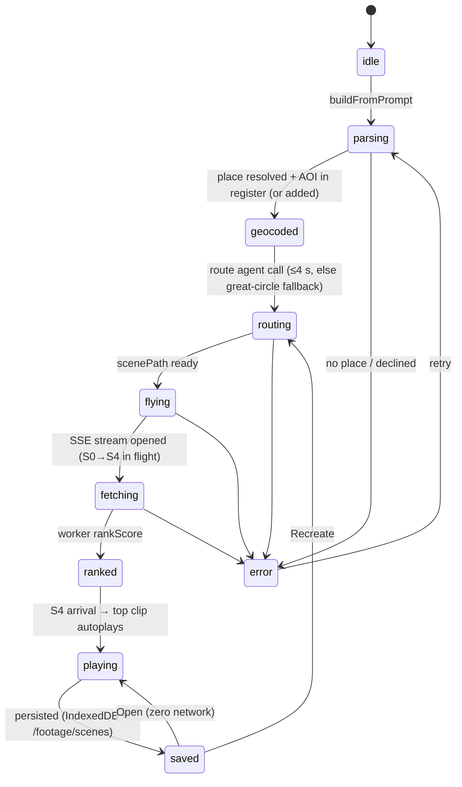

# Scene data model

See `src/gods-eye/scenes/models.js` for the factories; the shapes are reproduced verbatim in
`docs/gods-eye/CONTRACTS.md` §1. Summary:

- **Scene** — `id` (`s_` prefix), `title`, `prompt`, `label` (always `UAE Interest Watch`), `kind`
  (`live` | `incident` | `rebuild`), `aoi` (`id name country category inRegister`), `target`
  (`name lat lon geocodeSource confidence`), `tRef` (ISO-8601 UTC) + `tRefLabel`, `preset`
  (`alt 18000, heading, pitch 60, dwell [4.2, 11]`), `route` (`scenePath[] approachBearing groundRoutes[]
  alerts[] confidence basis fallback`), `camera` (`lat lon alt heading pitch roll stage`), `sources`
  (per platform `enabled status count latencyMs`), `footage[]`, `timeline` (`start end markers[]`),
  `lifecycle` (`createdAt lastBuiltAt buildCount isNew(<24 h) archivedAt(+72 h)`), `status`.
- **FootageItem** — `id sceneId platform mediaUrl thumbUrl authorHandle authorAvatar caption hashtags[]
  uploadedAt capturedAt? location{lat lon confidence basis} distanceKm timeDelta recency rankScore sourceUrl
  pluginMeta{icon rawPayloadRef}`; `diff` (`new|removed|unchanged`) is added by Recreate.

## State machine

## Ranking

`rankScore = 0.35·exp(−distanceKm/3) + 0.30·exp(−|timeDelta|/τ) + 0.25·relevance + 0.10·geoConf`
with `τ = 6 h` (live/incident) or `30 d` (rebuild) and `geoConf = exact 1 / inferred 0.6 / unknown 0.2`.
Recency: LIVE < 15 min, RECENT < 24 h, ARCHIVE otherwise; a `rebuild` scene is ARCHIVE throughout.

## Stage ladder (actually used)

| stage | altitude | pitch | travel | hold | reveals |
|---|---|---|---|---|---|
| S0 orbit | 8 000 km | −90° | 1.2 s | 1.5 s | globe, VIIRS night lights, all AOI rings, target region |
| S1 region | 1 200 km | −70° | 2.2 s | 1.5 s | country outline, scene AOI ring, ground routes fade in |
| S2 preset | 18 km | −60° | 2.6 s | 4.2 s | pins, 0.5/1/2 km rings, header populates |
| S3 aerial | 2 km | −45° | 2.2 s | 1.5 s | clusters expand, leader lines, route status labels |
| S4 place | 300 m on approach bearing | −30° | 2.3 s | 11 s | rail + timeline, top clip autoplays, then idle orbit |

Total travel 10.5 s (window 9–12 s); terrain/3D-tile collision guard before S4 (≥60 m AGL);
`prefers-reduced-motion` → `setView` cuts with 150 ms fades in the same order.
