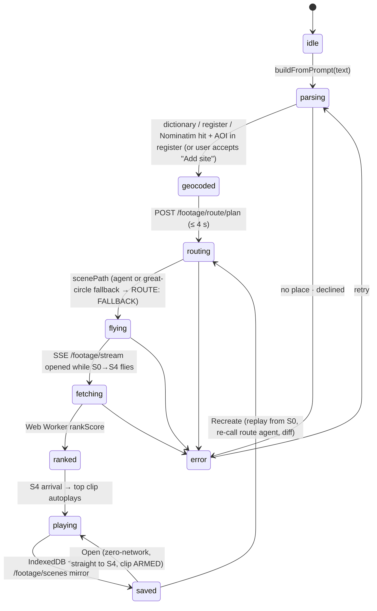

# Scene state machine

Stage events (`gev:scene-stage`): S0 → S1 → S2 → S3 → S4, each bound to a `camera.flyTo` completion
(or a `setView` cut under `prefers-reduced-motion`). Reveal layers per stage are listed in
`src/gods-eye/camera/ladder.js`. Every scene owns an `AbortSignal` (`store.beginScene`); a newer
scene aborts the older one's route call, flight, stream and monitor, and `mapLayers.clear(oldId)`
removes its pins/routes before the new scene renders.
